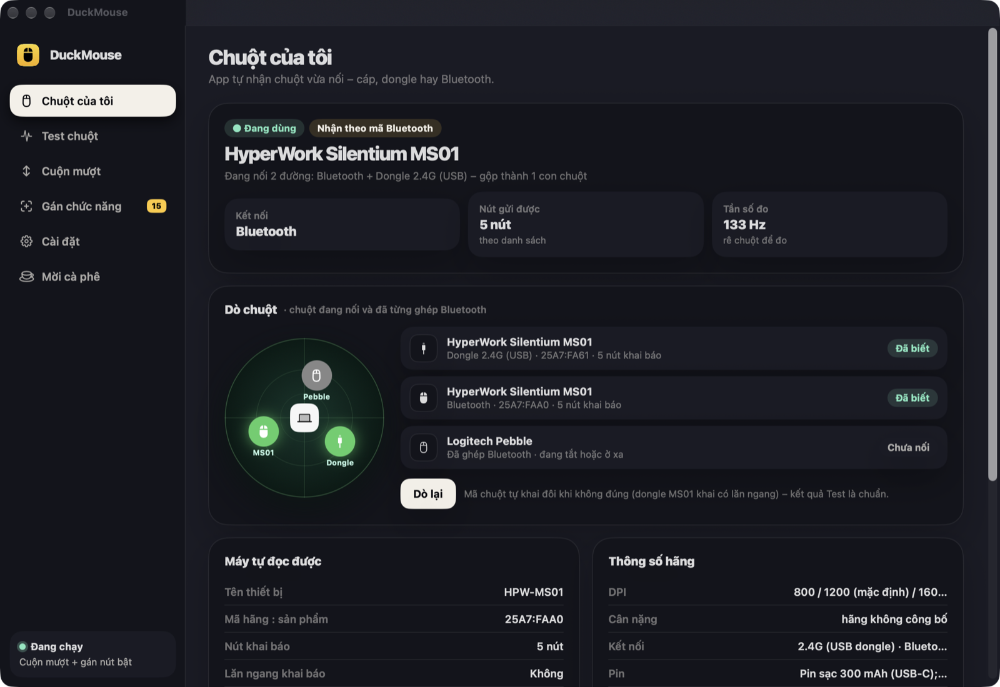
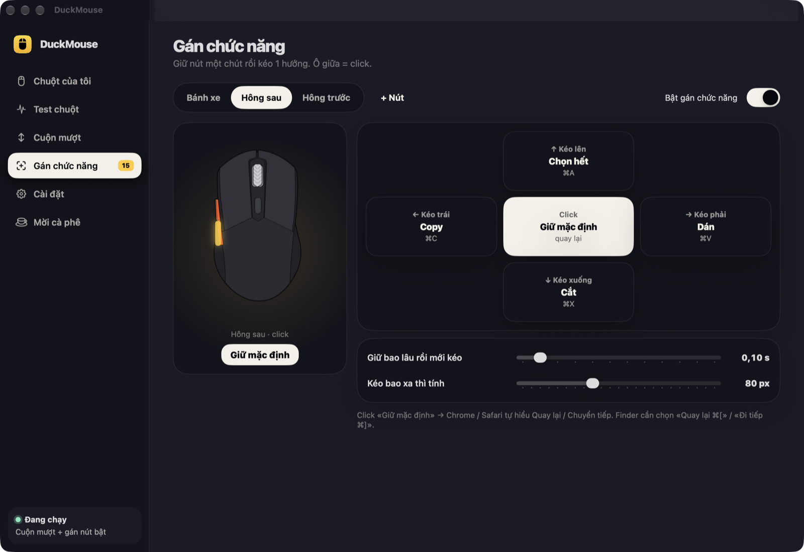
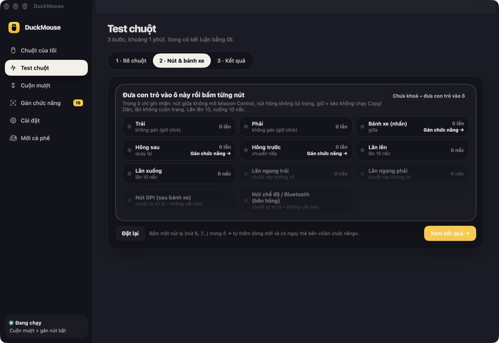

# DuckMouse

App chuột tiếng Việt cho macOS (chip Apple): **cuộn mượt** như trackpad, **gán chức năng** cho nút chuột bằng cách giữ nút rồi kéo 4 hướng, **test chuột** có kết luận bằng lời, và **nhận diện chuột** kèm thông số hãng (100 mẫu phổ biến). Viết bằng Swift, nhẹ khoảng 1 MB.



## Tính năng
- **Chuột của tôi** – tự nhận chuột vừa nối (cáp, dongle 2.4G, Bluetooth), hiện cả chuột từng ghép Bluetooth. Có sẵn thông số của 100 mẫu chuột văn phòng, silent, gaming (Logitech, Razer, HyperWork, Microsoft, Apple, Dell, SteelSeries, DareU, E-Dra…). Chuột lạ: chọn trong danh sách hoặc nhập tay, lần sau tự nhận.
- **Test chuột 3 bước (khoảng 1 phút)** – rê 10 giây đo độ mượt, độ đều, số lần khựng · ô thử nút: đưa con trỏ vào ô là mọi nút chỉ được *ghi nhận*, không chạy chức năng · kết quả bằng lời (xanh / vàng / đỏ), so với chuẩn từng kiểu kết nối và với lần test trước, chép kết quả để gửi bảo hành.
- **Cuộn mượt** – trôi chậm dần sau mỗi nấc lăn; ⌥ cuộn nhanh, ⇧ cuộn ngang, ⌘ tạm tắt. Trackpad và Magic Mouse giữ nguyên.
- **Gán chức năng** – mỗi nút (bánh xe, hông sau, hông trước, nút thêm) có 5 ô: click + giữ rồi kéo ← → ↑ ↓. Chọn trong 34 chức năng: Copy / Dán / Cắt / Hoàn tác, sang màn trái / phải (như vuốt 3 ngón), Mission Control, chụp vùng màn hình, tab trình duyệt, âm lượng, mở thư mục / app / trang web, phím tắt tự chọn… Hiện chữ nhỏ giữa màn hình mỗi khi chức năng chạy.
- **Mời cà phê** – app miễn phí; thấy hữu ích thì quét mã VietQR trong app để ủng hộ.
- Tự bật lại khi macOS tắt bộ bắt sự kiện (sau khi máy ngủ dậy). Tự nghỉ khi Mos đang chạy để không cuộn 2 lần.




## Cài đặt
Yêu cầu: macOS 14 trở lên, chip Apple (M1/M2/M3…).

1. Tải file **`.dmg`** mới nhất ở mục **[Releases](../../releases/latest)**.
2. Bấm đúp file DMG → kéo **DuckMouse** vào **Applications**.
3. Mở lần đầu: app chưa được Apple công chứng nên macOS sẽ chặn → **Cài đặt hệ thống → Quyền riêng tư & Bảo mật → Bảo mật → Vẫn mở**.
4. Cấp 2 quyền app xin (màn giới thiệu có nút mở thẳng): **Trợ năng** (cuộn mượt, gán nút) và **Theo dõi đầu vào** (đọc chuột, test).

👉 Hướng dẫn chi tiết: [HUONG-DAN-CAI.md](HUONG-DAN-CAI.md)

App chạy trên thanh menu (biểu tượng con chuột); khi cửa sổ đang mở thì có thêm biểu tượng trên Dock.

## Quyền riêng tư
App **không kết nối mạng**, không thu thập hay gửi dữ liệu. App chỉ đọc nút / bánh xe / di chuyển của chuột (không đọc bàn phím) và phát lại phím tắt bạn đã gán. Cài đặt lưu trong máy (`~/Library/Preferences/vn.vduck.DuckMouse.plist`, `~/Library/Application Support/DuckMouse/`).

## Tự build
```bash
bash "Ma nguon/build.sh"
```
Ra `DuckMouse.app` trong `$TMPDIR/DuckMouse-build`. Cần Xcode Command Line Tools. Ký app: đặt mã chứng chỉ vào biến `KY_APP` hoặc file `Ma nguon/.ky-app`; không có thì ký tạm (ad-hoc). Ký tạm thì mỗi bản build mới macOS coi là app khác → phải cấp lại quyền Trợ năng.

Mã nguồn: `Ma nguon/Sources/` (chú thích tiếng Việt) – `ScrollEngine` cuộn mượt · `ButtonEngine` nút + cử chỉ · `Actions` 34 chức năng · `MiceDB` nhận chuột + dữ liệu `Resources/mice.json` · `MouseHID` đọc chuột · các file `*View` giao diện.

## Ghi công
- Ý tưởng và tính năng: **Duck** tự nghĩ ra và làm (gán chức năng giữ nút + kéo 4 hướng, test chuột có kết luận bằng lời, nhận diện chuột + thông số 100 mẫu, giao diện tiếng Việt).
- Riêng thuật toán cuộn mượt dựa trên Mos của Caldis (CC BY-NC 4.0), làm lại bởi Duck – xem [LICENSE](LICENSE).
- Màu sắc, bo góc, hiệu ứng giao diện theo **Lucian UX/UI Prompt** – [Seokwoooo/lucian-uxui-prompt](https://github.com/Seokwoooo/lucian-uxui-prompt) (MIT).
- Mã nhận diện chuột đối chiếu với Solaar, OpenRazer, libratbag, rivalcfg, usb.ids, Linux hid-ids.h; thông số lấy từ trang các hãng (nguồn ghi trong từng mẫu). Tên hãng, tên sản phẩm thuộc về chủ sở hữu.

Giấy phép: [CC BY-NC 4.0](LICENSE) – được dùng, chia sẻ, sửa lại nếu ghi nguồn, **không dùng vào mục đích thương mại**.

© 2026 by Vduck
